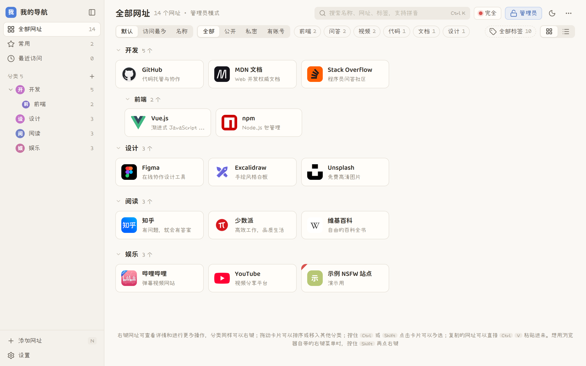
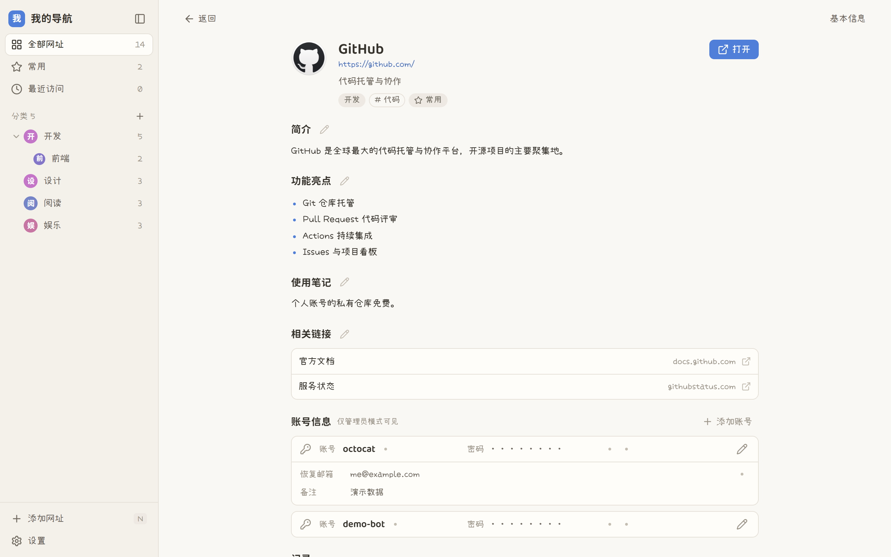
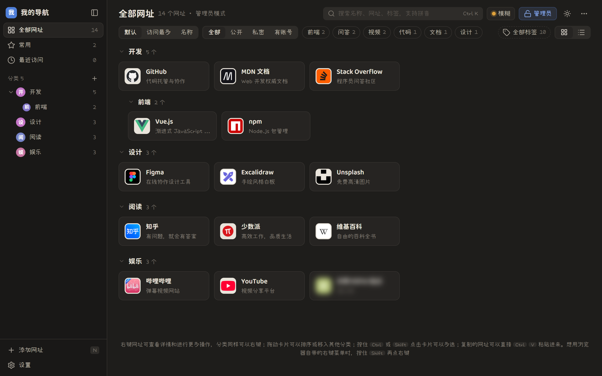

# 37-nav

自托管的个人网址导航。一个地方放下所有常用网址，顺便记住每个网站的账号，公开给别人看的和只给自己看的分得清清楚楚。



## 特点

- **公开 / 管理员两种模式**：访客只看到公开网址；输入管理密码（或来自白名单 IP）进入管理员模式后，才能看到私密网址、账号信息并编辑。
- **工作 / 模糊 / 完全三档**：网址和分类可以标记 NSFW。工作模式下一律隐藏（管理员也一样），模糊模式下打码、悬停看清，完全模式正常显示。
- **账号信息保管**：每个网址可以存多个账号，每个账号有密码、备注和任意自定义字段，加密入库，只在管理员模式下按需读取。
- **添加成本低**：导入浏览器书签文件（保留文件夹层级）、直接把书签或链接拖进页面、`Ctrl V` 粘贴网址、书签栏一键收藏，标题自动获取。
- **好找**：分类最多三层、可折叠，一个网址可以属于多个分类；另有标签、常用、最近访问；搜索支持拼音和首字母。
- **好整理**：拖拽排序、拖到分类上移动、右键菜单、`Ctrl` / `Shift` 点击多选后批量操作。
- **网址详情页**：简介、功能亮点、使用笔记、相关链接，各栏就地编辑、点别处自动保存；可以接入 AI 智能体自动填写，智能体读不到账号密码。
- **网站图标**：由服务器抓取并缓存，所有设备看到的都一样；编辑时会列出网站上找到的所有图标供挑选，也可以上传自己的（支持 HEIC、可裁切）。
- **手机和平板可用**：窄屏布局、长按菜单、底部弹窗。
- **部署简单**：没有需要编译的依赖，数据就是一个目录；端口等设置可以直接在网页里改。支持 Docker、systemd、pm2。
- **外观可调**：亮色 / 暗色、三档密度、强调色、自定义站点图标。

| 详情页 | 暗色 |
| --- | --- |
|  |  |

## 快速开始

需要 Node.js 22.13 或更高版本（Docker 方式不需要）。

**下载打包好的版本**（推荐）：到 [Releases](https://github.com/cute-37/37-nav/releases) 下载 `37-nav-1.2.0-full`，里面已经带好依赖，解压后：

```bash
npm start
```

**从源码运行**：

```bash
git clone https://github.com/cute-37/37-nav.git
cd 37-nav
npm ci --omit=dev
npm start
```

**Docker**：

```bash
docker compose up -d
```

然后打开 http://localhost:3080 ，第一次进入时设置管理密码。

部署到服务器（开机自启、反向代理和 HTTPS、离线 Docker 镜像、忘记密码怎么办）见 [DEPLOY.md](DEPLOY.md)。

## 配置

端口、监听地址、反向代理、对外地址、登录有效期都可以在网页的 设置 → 服务器 里修改，保存后立即生效。也可以用环境变量指定，这时网页里对应的输入框会锁定：

| 环境变量 | 默认 | 说明 |
| --- | --- | --- |
| `PORT` | `3080` | 监听端口 |
| `HOST` | `0.0.0.0` | 监听地址；只在本机用可设为 `127.0.0.1` |
| `DATA_DIR` | `./data` | 数据目录（`nav.db` 数据库 + `secret.key` 密钥） |
| `TRUST_PROXY` | 不信任 | 部署在反向代理后时必须设置，如 `1` 或 `loopback`（Express 的 trust proxy 取值） |

如果改错设置导致打不开页面，可以用环境变量临时覆盖后再进去改回来，例如 `PORT=3080 HOST=0.0.0.0 npm start`。

## 公开与私密

- **公开模式**：任何访问者可见，只读，只包含未标记私密的网址；没有公开网址的分类名也不会出现。
- **管理员模式**：输入管理密码或来自白名单 IP 后进入，可查看全部网址、账号信息并编辑。
- 网址自身标记私密，或所在分类是私密分类，都算私密。
- 账号信息（账号 / 密码 / 备注 + 自定义字段）无论网址是否公开，都只在管理员模式下按需读取，AES-256-GCM 加密后入库。
- 密码登录的设备切回公开模式即注销；白名单设备切回公开只是换视图（方便投屏、截图）。

## IP 白名单

设置 → 安全里填写，每行一个 IP 或 CIDR 网段。修改白名单和密码都要验证管理密码。

**反向代理注意**：不设置 `TRUST_PROXY` 时，服务看到的是代理的 IP（通常是 `127.0.0.1`）。此时若把 `127.0.0.1` 加进白名单，等于对所有人免密。设置页会显示服务端识别到的 IP，先确认它是你的真实 IP 再启用白名单。

## 网址详情与智能体接入

每个网址有一个详情页（右键 → 查看详情），预设四个字段：简介、功能亮点、使用笔记、相关链接。可以手动填，也可以让智能体自动补全。

在 设置 → 智能体 里生成令牌后，智能体用 `Authorization: Bearer <令牌>` 访问：

| 接口 | 作用 |
| --- | --- |
| `GET /api/agent/schema` | 字段说明 |
| `GET /api/agent/links` | 列出网址，`?missing=1` 只列还没有详情的 |
| `GET /api/agent/links/:id` | 读取单个网址 |
| `PUT /api/agent/links/:id/detail` | 写入详情（可同时带 `desc`、`tags`） |

权限边界：

- 这组接口不读取也不接受账号密码，请求里带 `secret`、`private` 等字段会被忽略。
- 默认只能看到公开网址；打开「允许访问私密网址」后才包含私密网址（地址本身会交给智能体）。
- 库里只保存令牌的哈希，令牌只在生成时显示一次；重新生成后旧令牌立即失效。
- 如果智能体运行在 IP 白名单内的机器上，它可以绕开这组接口直接调用普通接口并读到账号信息。**不要把运行智能体的机器放进白名单。**

可选的「新网址通知地址」会在添加网址时向该地址 POST `{ event: "links.created", links: [{ id, title, url }] }`。

## 备份

备份 `data/` 整个目录即可。`secret.key` 丢失后已保存的账号信息无法解密；它和 `nav.db` 一起泄露则等同明文，请限制该目录的访问权限。也可以在 设置 → 数据 导出 JSON 备份。

## 快捷键

`Ctrl K` 或 `/` 搜索 · `Enter` 打开第一个结果（无结果时用搜索引擎搜索）· `N` 添加网址 · `Ctrl` 点击多选 · `Ctrl A` 全选 · `Delete` 删除选中 · `Esc` 关闭

管理员模式下右键网址、分类或空白处有更多操作；按住 `Shift` 再右键可以用浏览器自带的菜单。

## 用到的开源组件

Express、helmet、cookie-session、express-rate-limit、bcryptjs、ipaddr.js（后端）；Vue、Fuse.js、pinyin-pro、SortableJS、Cropper.js、heic-to、Lucide（前端）；小赖字体、975 圆体（字体）。

## 许可证

[MIT](LICENSE)
